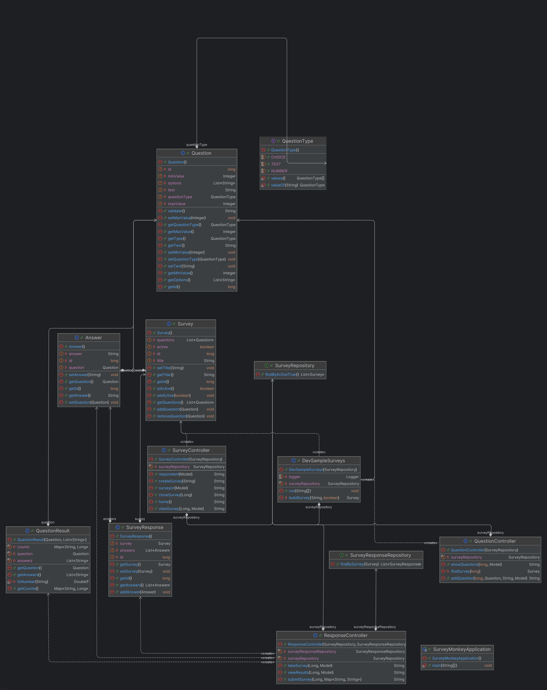

# Mini-SurveyMonkey (SYSC4806 Milestone Project)
The Mini-SurveyMonkey is a small web app where a surveyor creates a survey with questions, users fill it out, and the surveyor closes it to see the compiled results.

## Azure Live App
[Mini-SurveyMonkey Link](https://mini-survey-monkey-sysc4806-cfdjhqdddzf2ckhu.westus-01.azurewebsites.net)

## Team Members (Group 25)
- Rami Ayoub
- Mohammad Ahmadi
- Naomi Amaya Lovett 
- Liam Bennet 
- Andrew Tawfik 

## How to Run
Requires Java 21 or later and Maven.
```
git clone https://github.com/ramiayoub585/mini-survey-monkey.git
cd mini-survey-monkey
mvn package
java -jar target/Mini-SurveyMonkey-1.0-SNAPSHOT.jar
```
To start with sample surveys (one open and one closed), run the app with the `dev` profile instead:
```
java -jar target/Mini-SurveyMonkey-1.0-SNAPSHOT.jar --spring.profiles.active=dev
```
### Production database
The deployed app runs with the `prod` profile and uses an Azure Database for PostgreSQL
Flexible Server (`msm-group25-db`, Canada Central). Data persists across restarts.
Local runs and tests still use the in-memory H2 database by default.

The `prod` profile reads its connection settings from environment variables
(set in the Azure App Service → Environment variables, never committed):

| Variable | Value |
|---|---|
| `SPRING_PROFILES_ACTIVE` | `prod` |
| `DB_URL` | `jdbc:postgresql://<server>.postgres.database.azure.com:5432/surveydb?sslmode=require` |
| `DB_USERNAME` | database admin login |
| `DB_PASSWORD` | database password |

To run locally against the Azure database, set those variables and add your IP
to the server's firewall (Azure portal → server → Networking).

## Milestone 1 (Current Phase)
An early prototype of the application. The application is not fully polished but the main functionalities are working and are the following: 

- **Survey Creation:** A surveyor is able to create a survey and manage a list of the created surveys. 
- **Questions:** A surveyor can add a question (3 types: Text, Number, Choice) for the respondents to answer. 
- **Filling Out Survey:** A respondent selects from the list of open surveys and fills out all questions for that survey. Once the survey is closed, they can no longer answer. 
- **Closing and Results:** The surveyor closes the survey which becomes unavailable for the respondents. A results page is shown to the surveyor with the complied answers to the survey questions. The text answers are listed and number and choice answers are counted.
- **Tests and Sample Data:** Startup tests run CI, integration tests are also added (see test folders). A sample survey can be loaded using the dev profile (DevSampleSurveys). 

## Next Sprint 
- Adding a method for surveyor authentication, ie. login credentials.
- Displaying the results of the survey through charts (example: histogram, pie charts, etc.).
- Giving confirmation to the user once they have successfully answered a survey. 
- Having the ability to edit/delete a question from a survey. 
- Styling the different pages making them look nicer and aligning them together. 
- Handle some bugs, ie. remove the ability to add a question when a survey is closed, displaying min/max values to respondent for number questions, etc.
- Tests for the new features ensuring functionality of the program remains consistent. 

## UML Diagram


## Database Schema
Mini Survey Monkey uses Spring Data JPA with Hibernate ORM to manage database persistence. Mini Survey Monkey uses an H2 in-memory database where the database schema is automatically generated from the JPA entity classes when the application starts. 
The database is used to store surveys, questions, responses and answers.

### Main Entities
This table lists the entities and fields in the database.

| Entity | Fields | Description                                                                           |
|---|---|---------------------------------------------------------------------------------------|
| `Survey` | `id`, `title`, `active` | Stores a survey's identifier, title, and whether it is accepting responses.           |
| `Question` | `id`, `text`, `questionType`, `minValue`, `maxValue` | Stores questions belonging to surveys, including their type and number constraints.   |
| `SurveyResponse` | `id`, `survey` | Stores a completed survey submission referenced to the survey the submission answers. |
| `Answer` | `id`, `question`, `answer` | Stores an individual answer referenced to the question it answers.                    |

### Database Relationships
- **Survey → Question:** One-to-many. Each survey contains a list of questions. Questions are persisted using cascading operations.
- **Survey → SurveyResponse:** One-to-many. Each submitted response references a survey using a many-to-one relationship.
- **SurveyResponse → Answer:** One-to-many. Each response contains a list of answers, which are persisted using cascading operations.
- **Question → Answer:** One-to-many. Each answer references a question using a many-to-one relationship.

### Additional Database Tables
Hibernate also generates additional tables to persist collections and relationships:

- **Survey questions collection:** Maintains the association and ordering of questions within each survey.
- **Question options collection:** Stores the available options for multiple-choice questions and their order.
- **Survey response answers collection:** Maintains the association between survey responses and their answers.

### Question Types
Questions use the `QuestionType` enumeration, which has the following options:

- `TEXT`: Text responses.
- `NUMBER`: Numeric responses with optional min and max constraints.
- `CHOICE`: Multiple choice responses with a list of options.

### Database Configuration
Spring Boot configures the database connection, while Hibernate manages the database schema based on the JPA entity mappings.

Since the default database is in memory, its contents are not saved on application shut down.

## Project Status
[Mini-SurveyMonkey Board](https://github.com/users/ramiayoub585/projects/2)

| Column | Items                                                                                                                         |
|---|-------------------------------------------------------------------------------------------------------------------------------|
| Completed | Job 1 Setup and surveys, Job 2 Add questions to a survey, Job 3 Filling out, Job 4 Close and results and Job 5 Tests and demo |
| In progress | -                                                                                                                             |
| Backlog | -                                                                                                                             |

## Development Process
- Every feature is built on its own branch.
- Each change goes through a pull request reviewed by at least two other team members.
- CI (GitHub Actions) must pass before merging.
- Merged changes to `main` are deployed to Azure automatically.
- Weekly updates are posted in the "Weekly scrum" issues.


