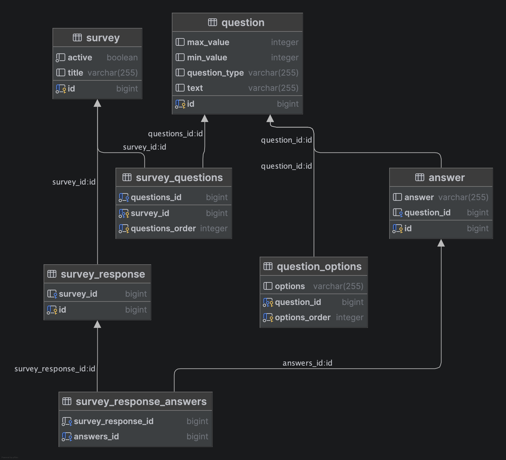

# Mini-SurveyMonkey (SYSC4806 Milestone Project)
The Mini-SurveyMonkey is a small web app where a surveyor creates a survey with questions, users fill it out, and the surveyor closes it to see the compiled results.

## Azure Live App
[Mini-SurveyMonkey Link](https://mini-survey-monkey-sysc4806-cfdjhqdddzf2ckhu.westus-01.azurewebsites.net)

## Team Members (Group 25)
- Rami Ayoub
- Mohammad Ahmadi
- Naomi Amaya Lovett 
- Liam Bennet 
- Andrew Tawfik 

## How to Run
Requires Java 23 or later and Maven.
```
git clone https://github.com/ramiayoub585/mini-survey-monkey.git
cd mini-survey-monkey
mvn package
java -jar target/Mini-SurveyMonkey-1.0-SNAPSHOT.jar
```
To start with sample surveys (one open and one closed), run the app with the `dev` profile instead:
```
java -jar target/Mini-SurveyMonkey-1.0-SNAPSHOT.jar --spring.profiles.active=dev
```
### Production database
The deployed app runs with the `prod` profile and uses an Azure Database for PostgreSQL
Flexible Server (`msm-group25-db`, Canada Central). Data persists across restarts.
Local runs and tests still use the in-memory H2 database by default.

The `prod` profile reads its connection settings from environment variables
(set in the Azure App Service → Environment variables, never committed):

| Variable | Value |
|---|---|
| `SPRING_PROFILES_ACTIVE` | `prod` |
| `DB_URL` | `jdbc:postgresql://<server>.postgres.database.azure.com:5432/surveydb?sslmode=require` |
| `DB_USERNAME` | database admin login |
| `DB_PASSWORD` | database password |

To run locally against the Azure database, set those variables and add your IP
to the server's firewall (Azure portal → server → Networking).

## Milestone 1 (Completed)
An early prototype of the application. The application is not fully polished but the main functionalities are working and are the following: 

- **Survey Creation:** A surveyor is able to create a survey and manage a list of the created surveys. 
- **Questions:** A surveyor can add a question (3 types: Text, Number, Choice) for the respondents to answer. 
- **Filling Out Survey:** A respondent selects from the list of open surveys and fills out all questions for that survey. Once the survey is closed, they can no longer answer. 
- **Closing and Results:** The surveyor closes the survey which becomes unavailable for the respondents. A results page is shown to the surveyor with the complied answers to the survey questions. The text answers are listed and number and choice answers are counted.
- **Tests and Sample Data:** Startup tests run CI, integration tests are also added (see test folders). A sample survey can be loaded using the dev profile (DevSampleSurveys). 

### Milestone 2 Plan (from Milestone 1)
- Adding a method for surveyor authentication, ie. login credentials.
- Displaying the results of the survey through charts (example: histogram, pie charts, etc.).
- Giving confirmation to the user once they have successfully answered a survey. 
- Having the ability to edit/delete a question from a survey. 
- Styling the different pages making them look nicer and aligning them together. 
- Handle some bugs, ie. remove the ability to add a question when a survey is closed, displaying min/max values to respondent for number questions, etc.
- Tests for the new features ensuring functionality of the program remains consistent. 

## Milestone 2 (Current Phase)
The alpha release. Everything from Milestone 1 works, plus the features and fixes from the TA's feedback:

- **Surveys:** A surveyor creates surveys and manages them from one list, with each survey marked Open or Closed.
- **Questions:** A surveyor adds text, number (with a min and max) and multiple-choice questions, and can edit or delete them. Questions are locked once a survey is closed or has answers.
- **Filling Out a Survey:** A respondent picks an open survey, answers every question and sees a confirmation page. Answers are checked on the server, and number questions show their allowed range. Closed surveys can no longer be answered.
- **Closing and Results:** The surveyor closes a survey after confirming. The results page lists text answers, shows a histogram for number questions and a pie chart for multiple-choice questions, with the counts underneath.
- **Navigation and Styling:** Every page shares a header with links home, to Manage surveys and to Take a survey. All pages use one stylesheet, work at phone width, and show a friendly page for errors such as a missing or closed survey.
- **Database:** Data is stored in a persistent database on Azure, so surveys and responses survive a restart.
- **Tests:** Unit and integration tests are split into files by behaviour and run in CI on every pull request. Sample surveys load with the `dev` profile (`DevSampleSurveys`).

Surveyor login, from the Milestone 2 plan above, was moved to Milestone 3.

## Milestone 3 Plan
The final release, shown at the final demo:

- **Surveyor login:** Surveyors sign in, and each surveyor only sees and manages their own surveys. Respondents can still answer without an account.
- **Form accessibility:** Every question on the fill and add-question pages gets a proper label, so the forms work with screen readers and keyboards.
- **Demo feedback:** Fix the bugs and usability issues found at the Milestone 2 demo.
- **Tests:** Tests for each new feature, keeping CI green on every pull request.

## UML Diagram
The class diagram for Milestone 2. It adds `OptionParser`, chart data in `QuestionResult`, editing and deleting questions in `QuestionController`, and the confirmation page in `ResponseController`. The source is `docs/uml-class-diagram.puml`.


The Milestone 1 diagram is kept in [docs/uml-class-diagram-milestone1.png](docs/uml-class-diagram-milestone1.png).

## Database Schema
Mini-SurveyMonkey uses Spring Data JPA with Hibernate as its ORM. The tables are generated
from the JPA entity classes. This diagram was generated from the production PostgreSQL database.



### Main Entities
This table lists the entities and fields in the database.

| Entity | Fields | Description                                                                           |
|---|---|---------------------------------------------------------------------------------------|
| `Survey` | `id`, `title`, `active` | Stores a survey's identifier, title, and whether it is accepting responses.           |
| `Question` | `id`, `text`, `questionType`, `minValue`, `maxValue` | Stores questions belonging to surveys, including their type and number constraints.   |
| `SurveyResponse` | `id`, `survey` | Stores a completed survey submission referenced to the survey the submission answers. |
| `Answer` | `id`, `question`, `answer` | Stores an individual answer referenced to the question it answers.                    |

### Database Relationships
- **Survey → Question:** One-to-many. Each survey contains a list of questions. Questions are persisted using cascading operations.
- **Survey → SurveyResponse:** One-to-many. Each submitted response references a survey using a many-to-one relationship.
- **SurveyResponse → Answer:** One-to-many. Each response contains a list of answers, which are persisted using cascading operations.
- **Question → Answer:** One-to-many. Each answer references a question using a many-to-one relationship.

### Additional Database Tables
Hibernate also generates additional tables to persist collections and relationships:

- **`survey_questions`**: join table linking each survey to its questions; `questions_order` keeps their order (`@OneToMany` + `@OrderColumn`).
- **`question_options`**: one row per multiple-choice option; `options_order` keeps their order (`@ElementCollection` + `@OrderColumn`).
- **`survey_response_answers`**: join table linking each response to its answers (`@OneToMany` without `mappedBy`).

### Question Types
Questions use the `QuestionType` enumeration, which has the following options:

- `TEXT`: Text responses.
- `NUMBER`: Numeric responses with optional min and max constraints.
- `CHOICE`: Multiple choice responses with a list of options.

### Database Configuration
Spring Boot configures the database connection, and Hibernate (the JPA ORM) creates and
updates the tables from the entity mappings (`spring.jpa.hibernate.ddl-auto=update`).

- **Local runs and tests:** in-memory H2 database. Its contents are lost when the application stops.
- **Deployed app (`prod` profile):** Azure Database for PostgreSQL Flexible Server. Data persists
  across restarts and redeploys. Connection settings come from environment variables (see How to Run).

## Project Status
[Mini-SurveyMonkey Board](https://github.com/users/ramiayoub585/projects/2)

| Column | Items |
|---|---|
| Completed | Job 1 Setup and surveys, Job 2 Add questions to a survey, Job 3 Filling out, Job 4 Close and results, Job 5 Tests and demo, Make repo public and protect main, Bundle 1 Real database and schema, Bundle 2 Edit/delete questions, Bundle 3 Answer validation, confirmation and test cleanup, Bundle 5 Results charts and multiple-choice fix |
| In progress | Bundle 4 Header, styling and README |
| Backlog | Milestone 3 plan above |

## Development Process
- Every feature is built on its own branch.
- Each change goes through a pull request reviewed by at least two other team members.
- CI (GitHub Actions) must pass before merging.
- Merged changes to `main` are deployed to Azure automatically.
- Weekly updates are posted in the "Weekly scrum" issues.

## Testing

The project uses JUnit 5 and Spring Boot MockMVC for automated testing. Tests are split by functionality to improve organization and make it easier to add new tests in the future.

All test files are located in `src/test/java/org/minisurveymonkey/`.

- **ApplicationTests.java** - Application startup and home page tests.
- **SurveyControllerTests.java** - Survey creation, listing, closing, and results tests.
- **QuestionControllerTests.java** - Question creation and validation tests.
- **ResponseControllerTests.java** - Survey submission and response persistence tests.
- **ErrorHandlingTests.java** - Error handling and invalid request tests.
- **QuestionDeleteAndAddTest.java** - Editing, deleting and locking questions.
- **OptionParserTests.java** - Parsing multiple-choice options.
- **QuestionResultsTests.java** - Results counts, histograms and pie chart data.
- **HeaderTests.java** - Shared header and navigation on every page.
- **ErrorPageTests.java** - Friendly 404, 403 and generic error pages.
- **TestHelpers.java** - Shared helper methods for creating test surveys and questions.

### Running Tests

To run all tests:

```
mvn clean test
```

To run a specific test class:

```
mvn -Dtest=ResponseControllerTests test
```

Maven automatically discovers and executes all test classes.

